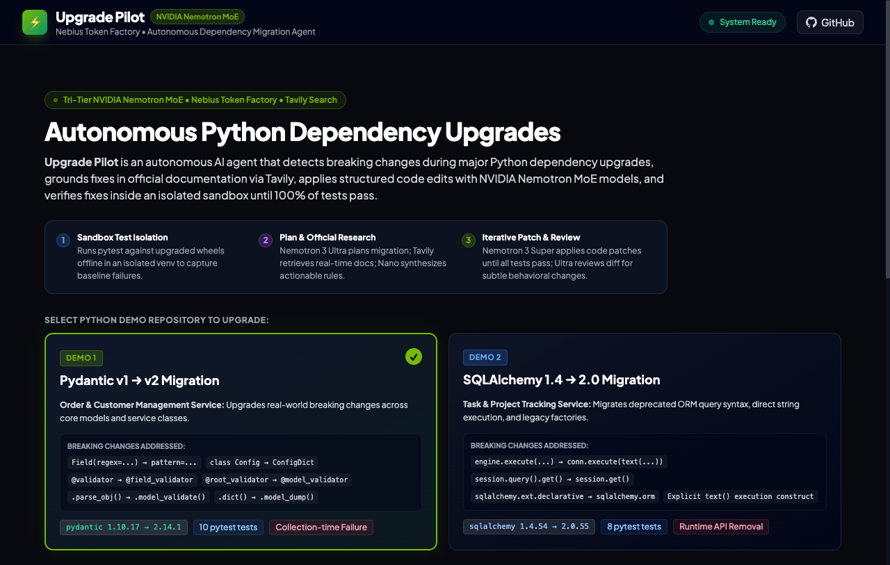
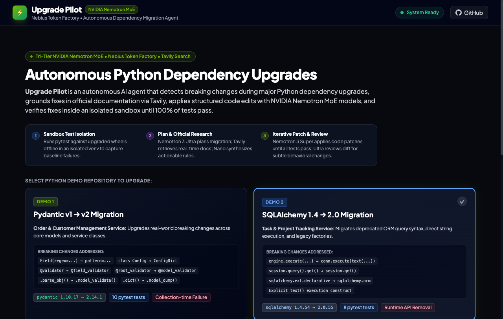
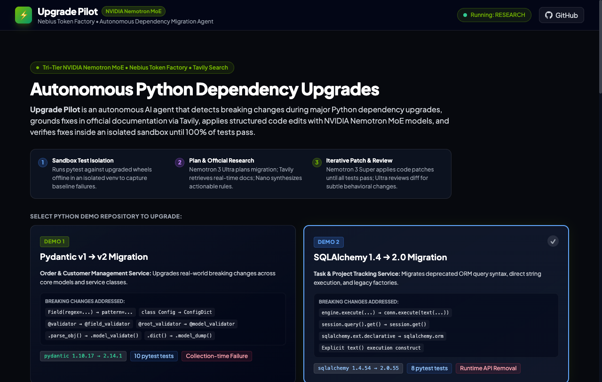
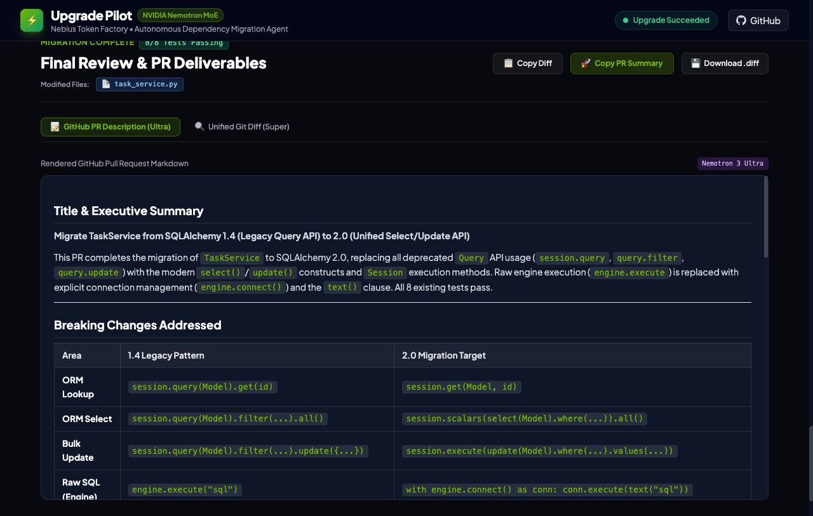
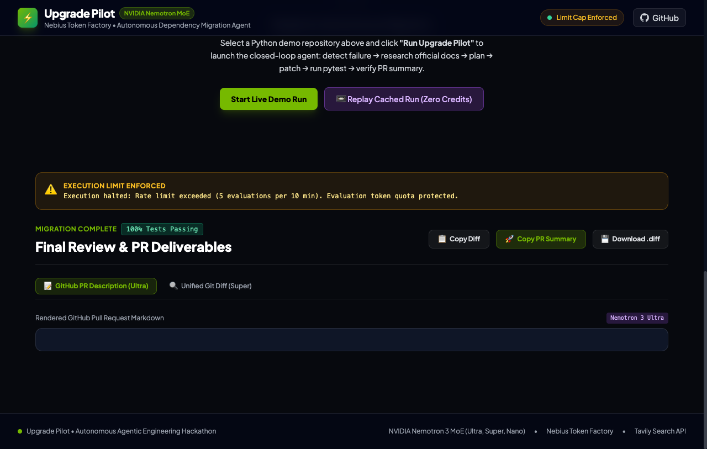
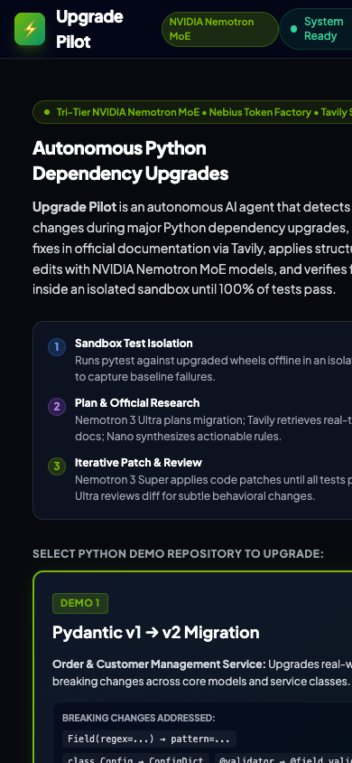

# Design System & UI Audit: Upgrade Pilot

> **Status**: Feature Freeze Active — Design Specification Only (No Code Changes)  
> **Target Visual Quality**: Professional, restrained developer-tool aesthetic in the spirit of Linear, Vercel Dashboard, and Stripe Docs.

---

## 1. Visual Evidence & Candid Audit of the Current UI

Below is an honest evaluation of the current interface across its 6 core application states, captured directly from the running web service on October 30, 2026.

### UI State Screenshots

| State | Preview | File Reference |
|---|---|---|
| **1. Landing (First Load)** |  | [`docs/screenshots/ui_audit_landing.png`](docs/screenshots/ui_audit_landing.png) |
| **2. Demo Selected** |  | [`docs/screenshots/ui_audit_demo_selected.png`](docs/screenshots/ui_audit_demo_selected.png) |
| **3. Run in Progress** |  | [`docs/screenshots/ui_audit_run_in_progress.png`](docs/screenshots/ui_audit_run_in_progress.png) |
| **4. Finished Run** |  | [`docs/screenshots/ui_audit_finished_run.png`](docs/screenshots/ui_audit_finished_run.png) |
| **5. Error / Cap State** |  | [`docs/screenshots/ui_audit_error_state.png`](docs/screenshots/ui_audit_error_state.png) |
| **6. Mobile View (390px)** |  | [`docs/screenshots/ui_audit_mobile_390px.png`](docs/screenshots/ui_audit_mobile_390px.png) |

---

### Candid Critical Audit

#### 1. Too Many Accent Colors (Visual "Circus")
* **Current Issue**: The interface currently uses at least **8 conflicting saturated accent colors** simultaneously:
  - Neon lime green (`#76b900` - NVIDIA branding) on the logo, active borders, checkmarks, and primary button.
  - Electric blue on Step 1, demo 2 badge, and test pills.
  - Purple on Step 2, Ultra badges, and the cached sample run button.
  - Rose/maroon on "Collection-time Failure" and "Runtime API Removal".
  - Sky blue on Tavily tags and search counters.
  - Emerald on the "System Ready" status badge.
  - Amber on iteration warning badges.
  - Dark brown/orange on the execution limit banner.
* **Why it fails**: When everything is colorful, nothing has hierarchy. Users cannot intuitively tell whether green means "NVIDIA", "Test Passed", or "Selected Demo". Semantic meaning is destroyed.

#### 2. Badge & Pill Clutter ("Pill Inflation")
* **Current Issue**: On the landing viewport alone, there are **17 distinct rounded pill badges**:
  - `NVIDIA Nemotron MoE`
  - `System Ready` (with pulsing dot)
  - `Tri-Tier NVIDIA Nemotron MoE • Nebius Token Factory • Tavily Search`
  - `Demo 1`
  - `Field(regex=...) → pattern=...`
  - `class Config → ConfigDict`
  - `@validator → @field_validator`
  - `@root_validator → @model_validator`
  - `.parse_obj() → .model_validate()`
  - `.dict() → .model_dump()`
  - `pydantic 1.10.17 → 2.14.1`
  - `10 pytest tests`
  - `Collection-time Failure`
  - Plus identical badge clusters for Demo 2.
* **Why it fails**: Putting every keyword, method name, library name, and version into an individual bubble turns the screen into visual noise. It looks like a tag cloud from 2011 rather than a precision engineering console.

#### 3. Jargon, Slogans & Redundant Text
* **Current Issue**: The interface repeats buzzwords endlessly:
  - Header: `"Upgrade Pilot • NVIDIA Nemotron MoE • Nebius Token Factory • Autonomous Dependency Migration Agent"`.
  - Eyebrow: `"Tri-Tier NVIDIA Nemotron MoE • Nebius Token Factory • Tavily Search"`.
  - Title: `"Autonomous Python Dependency Upgrades"`.
  - Description: `"Upgrade Pilot is an autonomous AI agent that detects breaking changes... with NVIDIA Nemotron MoE models..."`.
  - The word `"Autonomous"` is repeated **3 times in the first 4 lines**.
* **Why it fails**: Developers want to know: *What library is being upgraded? What broke? Where is the diff?* Marketing slogans and sponsor roll-calls clutter the workspace and delay user action.

#### 4. Weak Hierarchy & The "Fold" Problem
* **Current Issue**: On a standard laptop screen (1280×800 or 1440×900), the massive hero header and the 3-column pedagogical guide box (`1. Sandbox Isolation`, `2. Plan & Research`, `3. Patch & Review`) push the primary action buttons (`Run Upgrade Pilot`, `Replay Cached Run`) **completely below the fold**.
* **Why it fails**: A user landing on the page must scroll past decorative explanatory cards just to find the "Run" button. In a developer tool, the primary controls and the active workspace must be immediately visible without scrolling.

#### 5. Emoji Proliferation
* **Current Issue**: The interface litters emoji throughout the chrome: `📋 Copy Diff`, `🚀 Run Upgrade Pilot`, `💾 Download .diff`, `📝 GitHub PR Description`, `🔍 Unified Git Diff`, `⚙️ Empty State`, `📼 Cached Run`, `📦 Init`, `🧪 Baseline`, `🧠 Planning`, `🌐 Research`, `🛠️ Patching`, `🔬 Verifying`, `🏁 Review`, `⚡ Status`, `📄 File`.
* **Why it fails**: Emoji render inconsistently across operating systems (Apple Color Emoji vs Windows Segoe UI vs Linux Noto Emoji), have uneven line-heights, and impart a playful, toy-like tone rather than the serious credibility of a production developer tool.

#### 6. Stale & Contradictory Status Indicators
* **Current Issue**:
  - The top-right navbar holds a badge reading `"System Ready"` with a green pulsing dot. When an upgrade is running, it says `"Running: RESEARCH"`. When a limit cap is hit, it displays `"Limit Cap Enforced"` in amber text—**while still displaying a bright green pulsing dot**!
  - When the run completes, the deliverables header scrolls under the fixed navbar, cutting off titles and test badges.

#### 7. Mobile Viewport Collapse (390px)
* **Current Issue**:
  - The eyebrow pill truncates mid-sentence (`"• Tavily S..."`).
  - The header title wraps across 3 lines.
  - The 3 guide boxes stack into 3 giant blocks, forcing the user to scroll through ~900px of text before seeing demo cards.
  - The status badge and GitHub button crowd each other into an awkward flex-wrap.

---

## 2. The New Design System: Clean, Restrained Developer Tool

### Aesthetic Direction
In the spirit of **Linear**, **Vercel's console**, and **Stripe's developer documentation**:
- **Content-first, left-aligned, low visual noise**.
- **Generous structural whitespace** instead of boxed containers inside boxed containers.
- **Subtle 1px borders** (`#27272a` in dark mode, `#e4e4e7` in light mode) replacing heavy borders and glassmorphism.
- **Flat background tones** replacing gradients, radial glows, and blurry backdrops.
- **Zero emoji in system controls**; replaced by crisp, monochrome 16×16 inline SVG icons (Lucide style).

---

### Palette & CSS Variables

The new palette consists of:
1. **Neutral grays** for surfaces, text, and dividers.
2. **Exactly ONE brand accent color** (a restrained, technical blue: `#2563eb` light / `#3b82f6` dark).
3. **Semantic colors** (`success`, `warning`, `error`, `info`) reserved **strictly for status states** (test pass/fail, error banners, diff additions/deletions), never used as decorative card borders or random tag backgrounds.

```css
/* ==========================================================================
   UPGRADE PILOT TOKENS (LIGHT & DARK THEMES)
   ========================================================================== */

:root {
  /* Surface & Background */
  --bg-app: #ffffff;
  --bg-surface: #fafafa;
  --bg-subtle: #f4f4f5;
  --bg-overlay: #ffffff;

  /* Borders & Dividers */
  --border-default: #e4e4e7;
  --border-muted: #f4f4f5;
  --border-active: #a1a1aa;

  /* Typography */
  --text-primary: #09090b;
  --text-secondary: #71717a;
  --text-tertiary: #a1a1aa;
  --text-inverse: #ffffff;

  /* ONE Brand Accent (Developer Blue) */
  --accent-base: #2563eb;
  --accent-hover: #1d4ed8;
  --accent-subtle: #eff6ff;
  --accent-border: #bfdbfe;
  --accent-fg: #1d4ed8;

  /* Semantic Colors (Status ONLY) */
  --success-base: #16a34a;
  --success-bg: #f0fdf4;
  --success-border: #bbf7d0;
  --success-fg: #15803d;

  --error-base: #dc2626;
  --error-bg: #fef2f2;
  --error-border: #fecaca;
  --error-fg: #b91c1c;

  --warning-base: #d97706;
  --warning-bg: #fffbeb;
  --warning-border: #fde68a;
  --warning-fg: #b45309;

  /* Diff-specific tints */
  --diff-add-bg: #f0fdf4;
  --diff-add-text: #166534;
  --diff-del-bg: #fef2f2;
  --diff-del-text: #991b1b;

  /* Elevation */
  --shadow-sm: 0 1px 2px 0 rgba(0, 0, 0, 0.05);
  --shadow-md: 0 4px 6px -1px rgba(0, 0, 0, 0.06), 0 2px 4px -2px rgba(0, 0, 0, 0.04);
}

/* Dark Theme (via .dark class or prefers-color-scheme) */
[data-theme="dark"],
@media (prefers-color-scheme: dark) {
  :root:not([data-theme="light"]) {
    /* Surface & Background */
    --bg-app: #09090b;
    --bg-surface: #121215;
    --bg-subtle: #18181b;
    --bg-overlay: #1c1c20;

    /* Borders & Dividers */
    --border-default: #27272a;
    --border-muted: #1f1f23;
    --border-active: #52525b;

    /* Typography */
    --text-primary: #f4f4f5;
    --text-secondary: #a1a1aa;
    --text-tertiary: #71717a;
    --text-inverse: #09090b;

    /* ONE Brand Accent */
    --accent-base: #3b82f6;
    --accent-hover: #60a5fa;
    --accent-subtle: rgba(59, 130, 246, 0.1);
    --accent-border: rgba(59, 130, 246, 0.25);
    --accent-fg: #93c5fd;

    /* Semantic Colors (Status ONLY) */
    --success-base: #22c55e;
    --success-bg: rgba(34, 197, 94, 0.08);
    --success-border: rgba(34, 197, 94, 0.2);
    --success-fg: #4ade80;

    --error-base: #ef4444;
    --error-bg: rgba(239, 68, 68, 0.08);
    --error-border: rgba(239, 68, 68, 0.2);
    --error-fg: #f87171;

    --warning-base: #f59e0b;
    --warning-bg: rgba(245, 158, 11, 0.08);
    --warning-border: rgba(245, 158, 11, 0.2);
    --warning-fg: #fbbf24;

    /* Diff-specific tints */
    --diff-add-bg: rgba(34, 197, 94, 0.1);
    --diff-add-text: #86efac;
    --diff-del-bg: rgba(239, 68, 68, 0.1);
    --diff-del-text: #fca5a5;

    /* Elevation */
    --shadow-sm: 0 1px 2px 0 rgba(0, 0, 0, 0.3);
    --shadow-md: 0 4px 6px -1px rgba(0, 0, 0, 0.4);
  }
}
```

---

### WCAG AA Contrast Audit

| Text Element | Dark Mode Colors | Contrast Ratio | Light Mode Colors | Contrast Ratio | WCAG AA Status |
|---|---|---|---|---|---|
| **Primary Body Text** | `#f4f4f5` on `#09090b` | **17.8:1** (Req. 4.5:1) | `#09090b` on `#ffffff` | **19.8:1** | ✅ **Pass (AAA)** |
| **Secondary Metadata** | `#a1a1aa` on `#09090b` | **7.5:1** (Req. 4.5:1) | `#71717a` on `#ffffff` | **4.8:1** | ✅ **Pass (AA)** |
| **Accent Text / Links** | `#93c5fd` on `#09090b` | **11.2:1** (Req. 4.5:1) | `#1d4ed8` on `#ffffff` | **7.2:1** | ✅ **Pass (AAA)** |
| **Success Status Text** | `#4ade80` on `#09090b` | **10.8:1** (Req. 4.5:1) | `#15803d` on `#ffffff` | **5.4:1** | ✅ **Pass (AA)** |
| **Error Status Text** | `#f87171` on `#09090b` | **6.6:1** (Req. 4.5:1) | `#b91c1c` on `#ffffff` | **6.1:1** | ✅ **Pass (AA)** |
| **Warning Status Text**| `#fbbf24` on `#09090b` | **10.5:1** (Req. 4.5:1) | `#b45309` on `#ffffff` | **4.9:1** | ✅ **Pass (AA)** |
| **Interactive Borders**| `#52525b` on `#09090b` | **3.6:1** (Req. 3.0:1) | `#a1a1aa` on `#ffffff` | **3.3:1** | ✅ **Pass (UI Components)** |

---

### Typography Scale & Font Stack

To ensure bulletproof rendering offline without external Google Fonts dependencies, we use a battle-tested system font stack:

```css
/* Font Stacks */
--font-sans: -apple-system, BlinkMacSystemFont, "Segoe UI", Roboto, "Helvetica Neue", Arial, sans-serif;
--font-mono: "SF Mono", Monaco, "Cascadia Code", "Roboto Mono", Consolas, "Courier New", monospace;
```

#### Defined Scale
| Token | Font Size | Line Height | Weight | Letter Spacing | Purpose |
|---|---|---|---|---|---|
| `font-display` | `24px` (`1.5rem`) | `32px` | `600` | `-0.02em` | App Title / Hero Header |
| `font-h1` | `18px` (`1.125rem`) | `24px` | `600` | `-0.015em` | Section Titles (Deliverables, Timeline) |
| `font-h2` | `15px` (`0.9375rem`) | `20px` | `600` | `-0.01em` | Demo Card Titles, Stat Tile Labels |
| `font-h3` | `13px` (`0.8125rem`) | `18px` | `600` | `0` | Card Subtitles, Table Headers |
| `font-body` | `14px` (`0.875rem`) | `20px` | `400` | `0` | Primary Descriptions, Explanations |
| `font-small` | `12px` (`0.75rem`) | `16px` | `400` | `0.01em` | Metadata, Timestamps, Secondary Labels |
| `font-code` | `12px` (`0.75rem`) | `18px` | `400` | `0` | Code Snippets, Diff Text, Logs |

---

### Spacing, Grid & Layout Rules

* **Spacing Scale**: Multiples of 4px / 8px: `4px`, `8px`, `12px`, `16px`, `20px`, `24px`, `32px`, `48px`, `64px`.
* **Max Content Width**: `1120px` centered on the viewport. Generous horizontal padding (`24px` desktop, `16px` mobile).
* **Borders**: Strictly `1px solid var(--border-default)`. No heavy 2px or 4px borders.
* **Border Radius**:
  - `8px` (`0.5rem`) for cards, panels, modals, and input fields.
  - `6px` (`0.375rem`) for buttons, badges, and code blocks.
  - `4px` (`0.25rem`) for inline code tags.
* **Shadows**: Restrained single-layer drop shadows (`0 1px 2px rgba(0,0,0,0.05)`). No colored box-shadow glows.

---

### Iconography: Lucide-Style SVG (No Emoji)

All emojis are removed. In their place, we use 16×16 inline SVGs with `stroke-width="1.5"`, `stroke="currentColor"`, and `fill="none"`:

| Concept | Previous Emoji | Lucide-Style SVG Equivalent |
|---|---|---|
| **Run Upgrade** | 🚀 | `<path d="M5 12l14-7-7 14-2-5-5-2z"/>` (Compass / Play) |
| **Cached Playback** | 📼 | `<circle cx="12" cy="12" r="10"/><polygon points="10 8 16 12 10 16 10 8"/>` (Play Circle) |
| **Copy Action** | 📋 | `<rect width="14" height="14" x="8" y="8" rx="2"/><path d="M4 16c-1.1 0-2-.9-2-2V4c0-1.1.9-2 2-2h10c1.1 0 2 .9 2 2"/>` |
| **Download Diff** | 💾 | `<path d="M21 15v4a2 2 0 0 1-2 2H5a2 2 0 0 1-2-2v-4"/><polyline points="7 10 12 15 17 10"/><line x1="12" x2="12" y1="15" y2="3"/>` |
| **Diff Viewer Tab**| 🔍 | `<circle cx="11" cy="11" r="8"/><path d="m21 21-4.3-4.3"/>` |
| **PR Summary Tab** | 📝 | `<path d="M14 2H6a2 2 0 0 0-2 2v16a2 2 0 0 0 2 2h12a2 2 0 0 0 2-2V8z"/><polyline points="14 2 14 8 20 8"/>` |
| **Pass Status** | ✅ | `<path d="M20 6 9 17l-5-5"/>` |
| **Fail Status** | ❌ | `<path d="m18 6-12 12"/><path d="m6 6 12 12"/>` |
| **Warning / Cap** | ⚠️ | `<path d="m21.73 18-8-14a2 2 0 0 0-3.48 0l-8 14A2 2 0 0 0 4 21h16a2 2 0 0 0 1.73-3Z"/><line x1="12" y1="9" x2="12" y2="13"/><line x1="12" y1="17" x2="12.01" y2="17"/>` |
| **External Link** | 🌐 | `<path d="M18 13v6a2 2 0 0 1-2 2H5a2 2 0 0 1-2-2V8a2 2 0 0 1 2-2h6"/><polyline points="15 3 21 3 21 9"/><line x1="10" x2="21" y1="14" y2="3"/>` |

---

### Component Specifications

#### 1. Buttons
* **Primary**: `background: var(--text-primary)`, `color: var(--text-inverse)`, `font-weight: 500`, `font-size: 13px`, `padding: 7px 14px`, `border-radius: 6px`. Clean hover state with subtle opacity (`0.9`).
* **Secondary**: `background: var(--bg-surface)`, `color: var(--text-primary)`, `border: 1px solid var(--border-default)`.
* **Ghost**: `background: transparent`, `color: var(--text-secondary)`, hover: `background: var(--bg-subtle)`, `color: var(--text-primary)`.

#### 2. Demo Selector Cards
* Left-aligned, quiet card with `1px solid var(--border-default)`.
* **Selected State**: `border-color: var(--accent-base)`, subtle background tint (`var(--accent-subtle)`).
* Unselected State: Muted border, hover: `border-color: var(--border-active)`.
* Remove all 6 internal pills. Replace with a clean 2-line monospace diff summary:
  ```text
  Field(regex=...) -> pattern=...  |  class Config -> ConfigDict
  @validator -> @field_validator    |  .dict() -> .model_dump()
  ```

#### 3. Badges (Used Sparingly)
* Strict rule: Maximum 1 badge per card or row.
* Style: Flat, `font-size: 11px`, `font-weight: 500`, `padding: 2px 8px`, `border-radius: 4px`.
* No neon glows. No pill shapes (`rounded-full` replaced with `rounded-md`).

#### 4. Tabs
* Minimal flat underline tabs (`border-b: 1px solid var(--border-default)`).
* Active tab: `border-b: 2px solid var(--text-primary)`, `color: var(--text-primary)`, `font-weight: 500`.
* Inactive tab: `color: var(--text-secondary)`, hover: `color: var(--text-primary)`.

#### 5. Progress Indicator
* Slim `4px` linear progress bar (`background: var(--bg-subtle)`).
* Fill bar: `background: var(--accent-base)` (or `var(--success-base)` when 100%).
* Flanked by clear, left-aligned tabular text: `10 / 10 tests passing (100%)`.

#### 6. Timeline / Log Row
* Formatted like a clean developer log or commit list.
* Left border replaced with a subtle 1px timeline rule or table rows.
* Columns: `Timestamp (monospace)` | `Step Name` | `Model / Tool Tier` | `Summary`.
* Clicking a row expands the raw AST patch or pytest traceback in a monospace drawer.

#### 7. Diff Viewer
* Strict GitHub style:
  - Line additions: `background: var(--diff-add-bg)`, `color: var(--diff-add-text)`, `+` prefix.
  - Line deletions: `background: var(--diff-del-bg)`, `color: var(--diff-del-text)`, `-` prefix.
  - Line numbers: `color: var(--text-tertiary)`, non-selectable.
  - Monospace font: 12px `JetBrains Mono` / `SF Mono`.

#### 8. Stat Tiles (Cost & Telemetry Panel)
* 4 compact, borderless or single-border tiles:
  - Label: `font-size: 11px`, `color: var(--text-secondary)`, uppercase.
  - Value: `font-size: 20px`, `font-weight: 600`, tabular monospace.
  - Subtext: `font-size: 11px`, `color: var(--text-tertiary)`.
* No glowing colored borders or gradient backgrounds.

#### 9. Empty State
* Left-aligned empty state inside the timeline.
* No giant bouncy emoji.
* Brief instruction: `"Select a demo above and click Run to begin migration."`

#### 10. Error State Banner
* Muted, full-width alert container:
  - `background: var(--error-bg)`, `border: 1px solid var(--error-border)`, `color: var(--error-fg)`.
  - Inline SVG alert icon.
  - Clear technical explanation of the failure (e.g. Rate limit, daily budget cap, or pytest failure count).

---

### Banned Elements Table

The following visual patterns are **strictly forbidden** in the new design system:

| Forbidden Pattern | Why It Is Banned | Replacement |
|---|---|---|
| **Gradient Text** | Inconsistent contrast, looks like promotional marketing rather than a tool | Solid `var(--text-primary)` |
| **Glassmorphism (`backdrop-filter`)**| Legibility issues over scrolling content; high GPU draw overhead | Solid `var(--bg-surface)` with 1px border |
| **Box-Shadow Halos & Glows** | Visually cheap, obscures border alignment, looks dated | Crisp `1px solid var(--border-default)` |
| **Neon Badges** | Competes with actual error/warning states | Muted semantic tints (`var(--success-bg)`) |
| **Clusters of Pills** | Clutters layout, forces word wrapping, destroys visual calm | Inline comma-separated text or monospace code tags |
| **Centered-Everything Layouts** | Natural reading order for code & logs is left-to-right | Strict left-aligned layout |
| **Pulsing / Ping Animations** | Constant movement in peripheral vision causes cognitive fatigue | Static status dot (green = ready, blue = busy) |
| **More Than One Accent Color** | Colors lose semantic meaning | Single `--accent-base` blue; grays for everything else |
| **Emoji in System Controls** | Platform inconsistencies, breaks line-height | Lucide inline SVGs |

---

## 3. Motion & Animation Rules

Upgrade Pilot is a developer utility. Motion must be functional, subtle, and respect user system preferences.

1. **Duration**: Maximum `150ms` to `200ms`. Never exceed `250ms`.
2. **Easing Curve**: Standard deceleration curve:
   ```css
   --ease-default: cubic-bezier(0.16, 1, 0.3, 1); /* Quick entrance, smooth settle */
   ```
3. **Properties Allowed to Animate**:
   - `opacity` (fade in/out)
   - `transform` (subtle vertical shift: `translateY(2px)` to `0`)
   - `background-color` and `border-color` (hover states)
4. **Forbidden Animations**:
   - Continuous looping ping animations (`animate-ping`, `animate-pulse` on text).
   - Bouncing or elastic spring effects.
   - Layout-shifting height transitions.
5. **Accessibility Requirement**:
   Strict enforcement of `prefers-reduced-motion`:
   ```css
   @media (prefers-reduced-motion: reduce) {
     *, ::before, ::after {
       animation-duration: 0.01ms !important;
       animation-iteration-count: 1 !important;
       transition-duration: 0.01ms !important;
       scroll-behavior: auto !important;
     }
   }
   ```

---

## 4. Next Step Implementation Plan

When approval is granted to begin code changes:
1. Replace all CSS in `static/css/` with the CSS custom variables, typography scale, and dark/light mode definitions.
2. Refactor `static/index.html` to eliminate all gradient text, neon pill clusters, emoji, and nested glass panels.
3. Replace all button icons and status icons with clean inline Lucide SVGs.
4. Add theme toggle (System / Dark / Light) in the header.
5. Verify WCAG AA contrast, mobile responsiveness (390px), and offline functionality across both demos.
