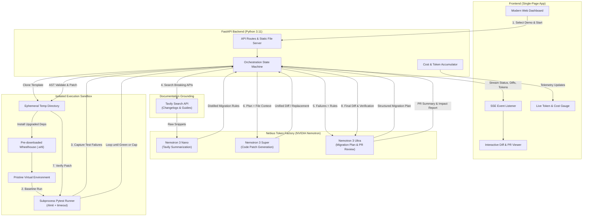
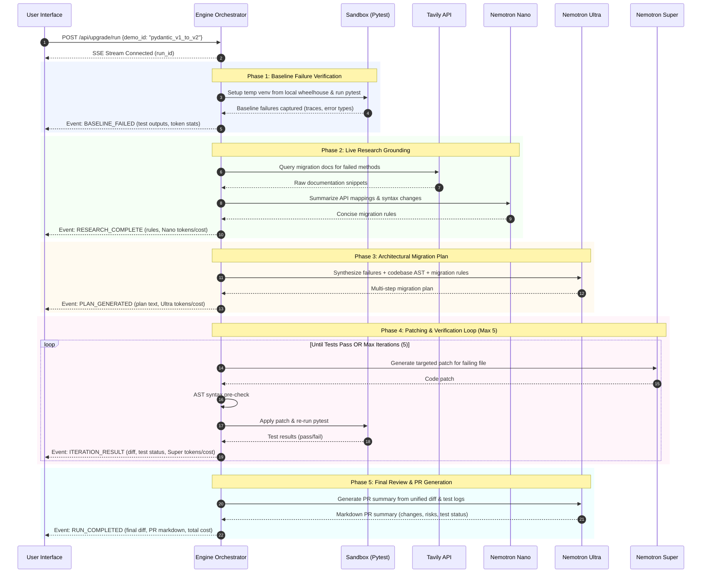
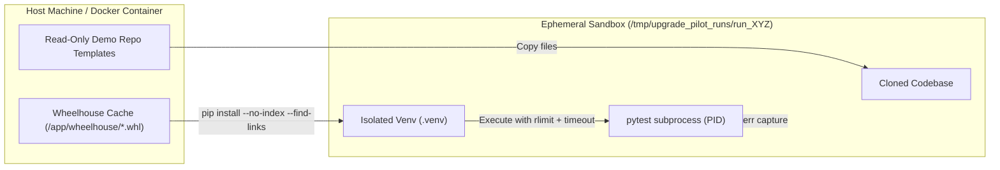

# Upgrade Pilot — Technical Specification & Implementation Plan

> **Hackathon Track**: Nebius x NVIDIA Global AI Hackathon — Coding and Agentic Engineering Track  
> **Target Delivery**: < 24 Hours  
> **Tech Stack**: Python 3.11, FastAPI, NVIDIA Nemotron (via Nebius Token Factory), Tavily API, pytest, Server-Sent Events (SSE), HTML5/Tailwind/Vanilla JS

---

## 1. Executive Summary & Judging Criteria Alignment

**Upgrade Pilot** is an autonomous dependency migration agent that upgrades Python codebases across major breaking changes (e.g., Pydantic v1 → v2, SQLAlchemy 1.4 → 2.0). Unlike general code assistants that hallucinate deprecated APIs, Upgrade Pilot uses a **tri-tier model architecture** powered by **NVIDIA Nemotron via Nebius Token Factory**, grounded by **real-time Tavily search** against official changelogs, and verified in an **isolated, local-wheelhouse Python sandbox**.

### Alignment with Judging Criteria (Equal Weight)
1. **Technological Implementation**: Multi-agent tier specialization (Nemotron Ultra for planning/review, Nemotron Super for code patching, Nemotron Nano for search summarization) with live token & cost telemetry, AST syntax validation, and an offline, secure pytest sandbox.
2. **Design (Complete Product, not a PoC)**: A responsive single-page web app with real-time SSE streaming, interactive diff viewer, live execution terminal, and exportable GitHub PR summaries.
3. **Potential Impact**: Eliminates hundreds of engineering hours lost to breaking library upgrades across the open-source and enterprise Python ecosystem.
4. **Quality of the Idea**: Solves real-world dependency hell with a closed-loop agent: **Fail → Research → Plan → Patch → Verify → PR**.

---

## 2. Architecture & Data Flow

### 2.1 System Architecture



### 2.2 Data Flow Pipeline



---

## 3. Project Directory Structure

```
upgrade-pilot/
├── PLAN.md                               # This master implementation plan
├── README.md                             # Hackathon submission doc, Nebius highlights, setup guide
├── LICENSE                               # MIT License
├── pyproject.toml                        # Project metadata & build tool configuration
├── requirements.txt                      # Server dependencies (FastAPI, uvicorn, openai, tavily-python, etc.)
├── Dockerfile                            # Production container with pre-built wheelhouse
├── .env.example                          # Environment configuration template
│
├── demo_repos/                           # Fixed read-only demo repositories (Security limit)
│   ├── pydantic_v1_to_v2/
│   │   ├── app/
│   │   │   ├── __init__.py
│   │   │   └── models.py                 # Uses v1 .dict(), parse_obj, @validator, Config class
│   │   ├── tests/
│   │   │   ├── __init__.py
│   │   │   └── test_models.py            # Comprehensive pytest suite failing on pydantic v2
│   │   ├── requirements-baseline.txt     # pydantic>=1.10,<2.0, pytest
│   │   └── requirements-upgraded.txt     # pydantic>=2.5,<3.0, pytest
│   │
│   └── sqlalchemy_v1_to_v2/
│       ├── app/
│       │   ├── __init__.py
│       │   ├── database.py               # Legacy engine setup
│       │   └── crud.py                   # Uses session.query(), legacy delete/update execution
│       ├── tests/
│       │   ├── __init__.py
│       │   └── test_crud.py              # Suite failing on SQLAlchemy 2.0 removal of legacy query
│       ├── requirements-baseline.txt     # sqlalchemy>=1.4,<2.0, pytest
│       └── requirements-upgraded.txt     # sqlalchemy>=2.0,<2.1, pytest
│
├── wheelhouse/                           # Pre-downloaded .whl files for offline, instant sandbox venvs
│   └── .gitkeep
│
├── scripts/
│   ├── predownload_wheels.sh             # Populates wheelhouse/ during build/setup
│   └── test_loop.py                      # Standalone CLI validation test
│
├── src/
│   └── upgrade_pilot/
│       ├── __init__.py
│       ├── config.py                     # Nebius & Tavily credentials, model tier mappings, cost tables
│       ├── models.py                     # Pydantic schemas for runs, events, telemetry, and API payloads
│       │
│       ├── llm/                          # Nebius Token Factory integrations
│       │   ├── __init__.py
│       │   ├── client.py                 # OpenAI-compatible client wrapper for Nebius Token Factory
│       │   ├── cost_tracker.py           # Per-tier token counting and USD cost estimation
│       │   ├── ultra.py                  # Migration planner and PR review agent (Nemotron 3 Ultra)
│       │   ├── super.py                  # Code patching agent (Nemotron 3 Super)
│       │   └── nano.py                   # Tavily search summarization agent (Nemotron 3 Nano)
│       │
│       ├── research/                     # Real-time documentation discovery
│       │   ├── __init__.py
│       │   ├── tavily_client.py          # Tavily search client with domain filtering (pydantic.dev, sqlalchemy.org)
│       │   └── fallback_cache.py         # Offline local docs fallback if Tavily is unavailable
│       │
│       ├── sandbox/                      # Local isolated execution environment
│       │   ├── __init__.py
│       │   ├── manager.py                # Tempdir lifecycle, venv creation, file replication
│       │   ├── runner.py                 # Subprocess pytest runner with timeout and rlimit controls
│       │   └── patcher.py                # Safe patch applier with AST syntax verification
│       │
│       ├── orchestrator/                 # Agent loop & event dispatcher
│       │   ├── __init__.py
│       │   ├── engine.py                 # Closed-loop state machine
│       │   └── events.py                 # SSE event emitter and run state repository
│       │
│       ├── api/                          # FastAPI REST & SSE endpoints
│       │   ├── __init__.py
│       │   └── routes.py                 # /api/demos, /api/upgrade/run, /api/upgrade/stream/{id}
│       │
│       ├── cli.py                        # CLI entrypoint for headless end-to-end testing
│       └── main.py                       # FastAPI application serving endpoints and static UI
│
└── static/                               # Frontend single-page app (served by FastAPI)
    ├── index.html                        # Sleek single-page dashboard
    ├── css/
    │   └── styles.css                    # Modern dark-mode UI with glassmorphism and accents
    └── js/
        ├── app.js                        # State management, SSE stream consumer, UI controllers
        ├── diff_viewer.js                # Live syntax-highlighted diff viewer
        └── telemetry.js                  # Real-time token and cost gauge animation
```

---

## 4. The 2 Prepared Demo Repositories

To guarantee deterministic, reliable, and deeply impressive live demonstrations, Upgrade Pilot includes two meticulously prepared Python repositories that exhibit classic, real-world dependency breakage:

### Demo 1: Pydantic v1 → v2 Migration (`pydantic_v1_to_v2`)
- **Baseline**: Pydantic 1.10.15
- **Upgraded**: Pydantic 2.8.2
- **Breaking Features Tested**:
  1. `.dict()` replaced by `.model_dump()`
  2. `.parse_obj()` replaced by `.model_validate()`
  3. `@validator` decorator replaced by `@field_validator` with `@classmethod` and `ValidationInfo`
  4. Inner `class Config:` replaced by `model_config = ConfigDict(...)`
  5. `regex=` in `Field()` replaced by `pattern=`
- **Initial Test State**: 5 tests run, 5 fail with `AttributeError` and `PydanticUserError`.
- **Target State**: 5 tests run, 5 pass.

### Demo 2: SQLAlchemy 1.4 → 2.0 Migration (`sqlalchemy_v1_to_v2`)
- **Baseline**: SQLAlchemy 1.4.52
- **Upgraded**: SQLAlchemy 2.0.31
- **Breaking Features Tested**:
  1. `session.query(Model).filter(...).all()` replaced by 2.0 `session.scalars(select(Model).where(...)).all()`
  2. `session.query(Model).get(id)` replaced by `session.get(Model, id)`
  3. `engine.execute("SELECT ...")` string execution removed; requires `connection.execute(text("..."))`
  4. `declarative_base()` migration to modern `DeclarativeBase` subclassing
- **Initial Test State**: 4 tests run, 4 fail with `RemovedIn20Warning` exceptions and `AttributeError`.
- **Target State**: 4 tests run, 4 pass.

---

## 5. Model Tiers & Nebius Token Factory Integration

Nebius Token Factory provides OpenAI-compatible API endpoints for NVIDIA Nemotron models. We map distinct agentic roles to optimal model sizes to balance capability, latency, and cost:

| Tier | Role | Model Name (Configured & Verified) | Why This Model? |
|---|---|---|---|
| **Nemotron 3 Ultra** | Migration Planning & Final Diff Review | `nvidia/Nemotron-3-Ultra-550b-a55b` | High reasoning capability (550B MoE with reasoning tokens) to analyze full file ASTs, cross-file dependencies, and generate GitHub PR descriptions with breaking change risk assessments. |
| **Nemotron 3 Super** | Code Patching Agent | `nvidia/nemotron-3-super-120b-a12b` | Fast, high-accuracy code completion (120B MoE) to generate targeted unified diffs or complete replacement functions adhering to strict Python syntax. |
| **Nemotron 3 Nano** | Tavily Summarization | `nvidia/NVIDIA-Nemotron-3-Nano-30B-A3B` | Ultra-low latency, low-cost summarizer (30B MoE) to distill verbose changelogs and search snippets into crisp 3-bullet migration rules. |

### Token & Cost Telemetry Formula
The application calculates real-time cost using configurable pricing rates per million tokens:
$$\text{Cost} = \sum_{t \in \{\text{Ultra}, \text{Super}, \text{Nano}\}} \left( \frac{\text{Input Tokens}_t \times \text{Price}_{\text{in}, t}}{10^6} + \frac{\text{Output Tokens}_t \times \text{Price}_{\text{out}, t}}{10^6} \right)$$

Default reference rates (overridable via environment variables):
- **Nemotron Nano**: \$0.10 / 1M input, \$0.20 / 1M output
- **Nemotron Super**: \$0.60 / 1M input, \$1.80 / 1M output
- **Nemotron Ultra**: \$2.00 / 1M input, \$6.00 / 1M output

The backend records usage after every single LLM call and emits updated metrics over the SSE stream.

---

## 6. Real-Time Stream Event Schema (SSE)

Communication between the FastAPI backend and the frontend uses standard **Server-Sent Events (`text/event-stream`)**. This guarantees instant updates, zero WebSocket handshake overhead, and resilience across proxies.

### Event Format Specification
Every event emitted follows the structure:
```json
{
  "event_id": "evt_01JBMX...",
  "run_id": "run_01JBMX...",
  "demo_id": "pydantic_v1_to_v2",
  "step": "INIT | BASELINE_TEST | RESEARCH | PLANNING | PATCHING | VERIFYING | REVIEW | COMPLETED | FAILED",
  "iteration": 1,
  "max_iterations": 5,
  "status": "pending | running | success | error",
  "message": "Applying patch for app/models.py to replace @validator with @field_validator...",
  "timestamp": "2026-10-29T01:45:00.123Z",
  "payload": {
    "test_summary": {
      "total": 5,
      "passed": 3,
      "failed": 2,
      "output_tail": "FAILED tests/test_models.py::test_parse_obj - AttributeError: type object 'User' has no attribute 'parse_obj'"
    },
    "research_findings": [
      {
        "query": "pydantic v2 parse_obj replacement",
        "rule": "Replace `.parse_obj(data)` with `.model_validate(data)`."
      }
    ],
    "plan_markdown": "1. Update imports from pydantic to include field_validator, ConfigDict.\n2. Migrate .dict() to .model_dump()...",
    "diff": "--- a/app/models.py\n+++ b/app/models.py\n@@ -12,4 +12,4 @@\n-    return user.dict()\n+    return user.model_dump()",
    "pr_summary": "### Upgrade Pilot: Pydantic v1 -> v2 Migration\n..."
  },
  "telemetry": {
    "current_tier": "super",
    "call_tokens": {
      "prompt": 1420,
      "completion": 210,
      "cost_usd": 0.00123
    },
    "cumulative": {
      "nano": { "tokens": 850, "cost_usd": 0.00013 },
      "super": { "tokens": 3200, "cost_usd": 0.00768 },
      "ultra": { "tokens": 2100, "cost_usd": 0.01680 },
      "total_tokens": 6150,
      "total_cost_usd": 0.02461
    }
  }
}
```

---

## 7. Sandbox Architecture & Security Constraints

Because Upgrade Pilot executes code and runs tests dynamically, isolation and predictability are paramount:



### 7.1 Sandbox Specifications

1. **Strict Ephemeral Isolation**:
   - Every run creates a fresh directory in `/tmp/upgrade_pilot_runs/{run_id}` via `tempfile.mkdtemp`.
   - Files are copied from the immutable `demo_repos/` directory.
   - Cleaned up automatically after run termination (or after a configurable TTL for inspection).
   - **No user-uploaded code is accepted** in the hosted version, eliminating arbitrary code execution threats from unauthenticated web traffic.

2. **Per-Run Virtual Environment with Offline Wheelhouse**:
   - Sandbox environments are created via:
     ```bash
     python3.11 -m venv /tmp/upgrade_pilot_runs/{run_id}/.venv --clear --without-pip
     ```
   - Pre-built wheelhouse contains all necessary wheels (`wheelhouse/*.whl`).
   - Pip installation runs strictly offline:
     ```bash
     /tmp/upgrade_pilot_runs/{run_id}/.venv/bin/pip install \
         --no-index \
         --find-links=/app/wheelhouse \
         -r requirements-upgraded.txt
     ```
   - **Benefits**: Zero network dependency during runs, immune to PyPI outages/rate limits, 1.5-second venv setup time instead of 30+ seconds.

3. **Subprocess Execution Controls & Resource Limits (POSIX `rlimit`)**:
   - Pytest is executed using `asyncio.create_subprocess_exec` inside the run directory.
   - Standard sanitized environment:
     ```python
     env = {
         "PATH": f"{venv_dir}/bin:/usr/bin:/bin",
         "PYTHONPATH": str(run_code_dir),
         "PYTHONDONTWRITEBYTECODE": "1",
         "PYTHONNOUSERSITE": "1",
     }
     ```
   - Wrapped with process group assignment (`preexec_fn=os.setsid`) to guarantee clean termination.
   - Subprocess execution safeguards:
     - **Execution Timeout**: Hard cap of 20 seconds per pytest run. On timeout, sends `SIGKILL` to the entire process group `os.killpg(pgid, signal.SIGKILL)`.
     - **CPU Time Limit (`RLIMIT_CPU`)**: Soft 15s, hard 20s.
     - **Virtual Memory Limit (`RLIMIT_AS`)**: Capped at 512 MB to prevent memory-hogging loops.
     - **File Size Limit (`RLIMIT_FSIZE`)**: Capped at 10 MB to prevent rogue disk-filling logs.
     - **Process Fork Limit (`RLIMIT_NPROC`)**: Capped at 32 to prevent fork bombs.

4. **AST Syntax Validation Before Sandbox Application**:
   - Before any patch from Nemotron 3 Super is written to disk, it passes through `ast.parse(patched_code)`.
   - If a syntax error is detected, the sandbox run is skipped; the syntax traceback is directly fed back to Nemotron 3 Super to fix its formatting immediately.

---

## 8. Failure Modes & Resilience Strategies

| Failure Mode | Root Cause | Fallback / Mitigation Strategy |
|---|---|---|
| **Nebius Token Factory 429 / Rate Limit** | Concurrent requests or burst quota exceeded | Exponential backoff retry with jitter (3 attempts: 1s, 2s, 4s). If still failing, gracefully alert the UI with an informative error event. |
| **Model Context Window Exceeded** | Massive test tracebacks or large diffs | Intelligent AST & traceback pruning: Keep only the failing assertion lines and top 3 stack frames; summarize Tavily outputs to < 300 words. |
| **Tavily API Failure / Rate Limit** | Tavily service degradation or expired API key | Built-in offline fallback cache: Curated markdown cheat sheets for Pydantic v2 and SQLAlchemy 2.0 bundled directly in the repo. Agent continues seamlessly without failing. |
| **Patch Application Failure** | LLM hallucinated wrong line numbers in diff | Dual-mode patching: Try standard unified diff patch first. If diff fails to apply cleanly, fall back to whole-file replacement mode with AST validation. |
| **Infinite Flapping Loop** | Patch fixes test A but breaks test B back and forth | Hard cap at 5 iterations. State history tracks seen test failure hashes; if a cycle is detected, prompt Nemotron 3 Ultra to re-plan holistically. |
| **Client Disconnect During Run** | User refreshes page or network flickers | Run state persists in memory on backend. Client reconnects with `?run_id=...` and receives state snapshot + continues streaming live SSE events. |
| **Sandbox Execution Hang** | Infinite loop introduced in patched user code | Subprocess hard timeout kills the process group after 20s; registers as `TEST_TIMEOUT` failure and passes timeout report back to the patching agent. |

---

## 9. Implementation Task Breakdown & 24-Hour Time Budget

```
Total Time Budget: 24 Hours
Planned Engineering Time: 18.5 Hours
Buffer for Unforeseen Issues & Submission Polish: 5.5 Hours
```



```mermaid
gantt
    title Upgrade Pilot 24-Hour Implementation Timeline
    dateFormat  HH:mm
    axisFormat  %H:%M

    section Phase 1: Core Engine
    Setup & Demo Repos           :m1, 00:00, 2h
    Sandbox & Offline Wheelhouse :m2, after m1, 1.5h
    CLI Working Loop (M1)        :m3, after m2, 1.5h

    section Phase 2: Nebius & Tavily
    Nebius Token Factory Clients :m4, after m3, 1.5h
    Tavily Integration & Nano    :m5, after m4, 1.5h
    Tri-Tier Agent Validation    :m6, after m5, 1.0h

    section Phase 3: Web & Stream
    FastAPI & SSE Event Engine   :m7, after m6, 2.5h
    Frontend Dashboard & Diff UI :m8, after m7, 3.5h

    section Phase 4: Deploy & Polish
    Dockerization & Hosted URL   :m9, after m8, 2.0h
    Docs, README & Submission Materials :m10, after m9, 2.0h
    Safety Buffer & Submission   :m11, after m10, 5.0h
```

### Detailed Task List

#### Task Group 1: Workspace Setup & Sandbox Foundation (3.5 Hours)
- [ ] **Task 1.1**: Initialize repo structure, `pyproject.toml`, `requirements.txt`, and MIT `LICENSE`. (0.5h)
- [ ] **Task 1.2**: Create the two demo repositories (`demo_repos/pydantic_v1_to_v2` and `demo_repos/sqlalchemy_v1_to_v2`) with failing pytest suites. (1.0h)
- [ ] **Task 1.3**: Implement `scripts/predownload_wheels.sh` to download offline wheels into `wheelhouse/`. (0.5h)
- [ ] **Task 1.4**: Implement `sandbox/manager.py` and `sandbox/runner.py` with tempdir cloning, offline venv installation, and `rlimit`/timeout pytest execution. (1.5h)

#### Task Group 2: Model Tiers & Research Integration (3.0 Hours)
- [ ] **Task 2.1**: Implement `llm/client.py` and `llm/cost_tracker.py` for Nebius Token Factory with configurable base URL and model IDs. (1.0h)
- [ ] **Task 2.2**: Implement `research/tavily_client.py` with domain-focused changelog queries and `research/fallback_cache.py`. (0.5h)
- [ ] **Task 2.3**: Implement prompt wrappers:
  - `llm/nano.py`: Fast Tavily summarization.
  - `llm/ultra.py`: Architectural planning & PR generation.
  - `llm/super.py`: Targeted code patching with AST pre-checks (`sandbox/patcher.py`). (1.5h)

#### Task Group 3: Command-Line End-to-End Verification (1.5 Hours)
- [ ] **Task 3.1**: Build `cli.py` to run the full closed loop in the terminal:
  `Baseline fail → Tavily search → Nano summarize → Ultra plan → Super patch → Pytest pass → Ultra PR summary`. (1.0h)
- [ ] **Task 3.2**: Verify that both demo repos successfully reach 100% test pass rates headless from the command line. (0.5h)

#### Task Group 4: Streaming Backend & API (2.5 Hours)
- [ ] **Task 4.1**: Implement `orchestrator/events.py` event state machine and SSE formatting. (1.0h)
- [ ] **Task 4.2**: Implement FastAPI routes in `api/routes.py` (`GET /api/demos`, `POST /api/upgrade/run`, `GET /api/upgrade/stream/{id}`). (1.0h)
- [ ] **Task 4.3**: Integrate live token counting and cost accumulation per tier into the event stream. (0.5h)

#### Task Group 5: High-Polish Frontend UI (3.5 Hours)
- [ ] **Task 5.1**: Build `static/index.html` with a modern dark-mode aesthetic, repo selection dropdown, run controls, and terminal view. (1.0h)
- [ ] **Task 5.2**: Implement `static/js/app.js` SSE client handling state transitions, step progress bar, and test status indicators. (1.0h)
- [ ] **Task 5.3**: Implement `static/js/diff_viewer.js` rendering interactive, syntax-highlighted side-by-side/inline diffs and PR summary markdown. (1.0h)
- [ ] **Task 5.4**: Implement `static/js/telemetry.js` showing live token count counters and dollar cost estimates for Ultra, Super, and Nano. (0.5h)

#### Task Group 6: Containerization & Deployment (2.0 Hours)
- [ ] **Task 6.1**: Author `Dockerfile` that packages Python 3.11, pre-downloads the wheelhouse, and starts Uvicorn. (1.0h)
- [ ] **Task 6.2**: Deploy to hosted infrastructure (e.g., Nebius Cloud Compute VM, Fly.io, or Railway) and verify public URL. (1.0h)

#### Task Group 7: Hackathon Deliverables & Submission (2.0 Hours)
- [ ] **Task 7.1**: Write comprehensive `README.md` highlighting NVIDIA Nemotron usage, Nebius Token Factory speed/cost advantages, architecture diagram, and local setup instructions. (1.0h)
- [x] **Task 7.2**: Complete written submission materials (README, DEVPOST, FEEDBACK) with cost and token audit. (1.0h)
- [ ] **Safety Buffer**: (5.5 Hours reserved for edge-case bug fixes and judging submission).

---

## 10. Flagged Uncertainties & Open Questions for the User

Before proceeding with application code, please review and advise on the following items:

### Question 1: Nebius Token Factory Model Identifiers
> In Nebius Token Factory, what are your exact provisioned model IDs for the Nemotron tiers?  
> *Proposed Default*: We have parameterized them via `.env` as:
> - `NEBIUS_BASE_URL` (default: `https://api.tokenfactory.nebius.com/v1`)
> - `MODEL_TIER_ULTRA` (e.g., `nvidia/nemotron-4-340b-instruct` or `nvidia/nemotron-3-ultra`)
> - `MODEL_TIER_SUPER` (e.g., `nvidia/nemotron-3-super` or `nvidia/nemotron-4-70b-instruct`)
> - `MODEL_TIER_NANO` (e.g., `nvidia/nemotron-3-nano` or `nvidia/nemotron-mini-4b-instruct`)  
> **Do you have specific endpoint names you want hardcoded as defaults?**

### Question 2: Model Pricing Rates for Telemetry
> Does Nebius publish specific token pricing for your account, or should we use standard reference rates (\$0.10 / \$0.60 / \$2.00 per 1M tokens) to display estimated cost savings?

### Question 3: Target Hosting Environment
> Where do you plan to deploy the hosted demo URL?
> - **Option A (Recommended for Hackathon Judges)**: A Nebius Cloud Compute instance (VM with Docker), allowing us to pitch *100% Nebius Infrastructure* (Compute + Token Factory).
> - **Option B**: Managed PaaS (Fly.io, Railway, or Render) with a single `docker run`.  
> *Which deployment target do you have credentials ready for?*

### Question 4: Demo Repository Selection
> Are you happy with **Pydantic v1 → v2** and **SQLAlchemy 1.4 → 2.0** as the two featured demos? Both are infamous, universally recognized breaking upgrades that showcase high technical capability without overwhelming the sandbox.
