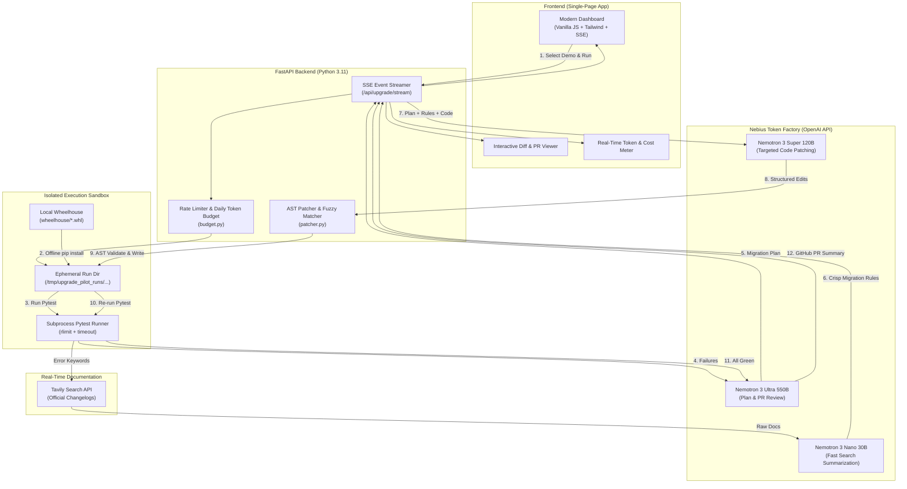

# Upgrade Pilot 🚀
### Autonomous Python Dependency Migration Agent
**Nebius x NVIDIA Global AI Hackathon — Coding and Agentic Engineering Track**

[](https://opensource.org/licenses/MIT)
[](https://www.python.org/downloads/)
[](https://www.nvidia.com)
[](https://nebius.com)

---

## Pitch

Every software team dreads major dependency upgrades. When foundational libraries like **Pydantic** (v1 → v2) or **SQLAlchemy** (1.4 → 2.0) introduce breaking changes, codebases break across dozens of files, documentation is scattered across sprawling changelogs, and developers lose days to manual syntax migration.

**Upgrade Pilot** is a specialized, closed-loop agentic engineer that autonomously upgrades Python services across breaking major versions. It provisions an isolated execution sandbox, detects failing tests, plans the migration using **NVIDIA Nemotron 3 Ultra**, grounds its fixes in live official changelogs via **Tavily Search** summarized by **Nemotron 3 Nano**, generates syntax-checked AST patches with **Nemotron 3 Super**, and iterates in a deterministic sandbox until the test suite is green—streaming real-time diffs, token telemetry, and an exportable GitHub Pull Request description.

---

## Screenshot & Live UI Preview

```text
+----------------------------------------------------------------------------------------------------+
|  UPGRADE PILOT   [NVIDIA Nemotron] [Nebius Token Factory]                           [● System Ready] |
+----------------------------------------------------------------------------------------------------+
|  DEMO PICKER:                                                                                      |
|  [✓] Demo 1: Pydantic v1 → v2 (10 tests)       [ ] Demo 2: SQLAlchemy 1.4 → 2.0 (8 tests)         |
|  [ > Run Upgrade Pilot ]                                                                           |
+----------------------------------------------------------------------------------------------------+
|  REAL-TIME TELEMETRY PANEL                                                                         |
|  Total Cost: $0.071420 | Ultra: 5,863 tok ($0.023) | Super: 41,922 tok ($0.046) | Nano: 1,220 tok ($0.0001) |
+----------------------------------------------------------------------------------------------------+
|  TEST PASS RATE: [========================================] 100% (10/10 Tests Passing)            |
+----------------------------------------------------------------------------------------------------+
|  LIVE EVENT STREAM:                                                                                |
|  🧪 [BASELINE]  Pytest failed: Field(regex=...) removed in Pydantic v2                             |
|  🧠 [PLANNING]  Nemotron 3 Ultra formulated 6-step AST refactoring plan                            |
|  🌐 [RESEARCH]  Tavily + Nemotron 3 Nano extracted 4 migration rules with source links              |
|  🛠️ [PATCHING]  Nemotron 3 Super applied 5 edits (regex→pattern, ConfigDict, @field_validator)     |
|  🔬 [VERIFY]    Sandbox pytest passed (10/10 green)                                                |
|  🏁 [REVIEW]    Nemotron 3 Ultra verified diff & drafted production GitHub PR description          |
+----------------------------------------------------------------------------------------------------+
|  FINAL DELIVERABLES:  [ Copy Diff ]  [ Copy PR Summary ]                                           |
|  - Unified Git Diff Viewer (Syntax-highlighted additions / deletions)                             |
|  - Production-grade GitHub PR Description (Markdown) with verified source citations               |
+----------------------------------------------------------------------------------------------------+
```

---

## Architecture & Agent Pipeline



---

## How We Use NVIDIA Nemotron

Upgrade Pilot implements a **tri-tier model specialization strategy** via Nebius Token Factory, matching each agent task to the ideal model size, reasoning depth, and latency characteristics:

| Model Tier | Model Identifier | Role | Why This Model? |
|---|---|---|---|
| **Nemotron 3 Ultra** | `nvidia/Nemotron-3-Ultra-550b-a55b` | Architectural Migration Planning & Final PR Review | 550B MoE with deep chain-of-thought reasoning tokens. Analyzes full codebase ASTs, cross-file relationships, and generates comprehensive GitHub PR descriptions with breaking-change risk analyses and documentation citations. |
| **Nemotron 3 Super** | `nvidia/nemotron-3-super-120b-a12b` | Targeted Code Patching & Error Repair | 120B MoE with high code-generation precision. Generates concise Search/Replace blocks or full-file replacements. Auto-repairs malformed syntax when prompted. |
| **Nemotron 3 Nano** | `nvidia/NVIDIA-Nemotron-3-Nano-30B-A3B` | Real-Time Documentation Summarization | 30B MoE with near-instantaneous time-to-first-token (TTFT). Condenses dense 800-word documentation pages from Tavily into precise 1-sentence actionable migration rules at negligible cost ($0.10/1M input). |

*Telemetry Insight*: Both Nemotron 3 Ultra and Super output dedicated `reasoning_tokens`, which Upgrade Pilot extracts from Nebius usage details and displays in real time on the frontend cost panel.

---

## Where Nebius Token Factory Helped

1. **Unified OpenAI-Compatible Endpoints**:
   Nebius Token Factory allowed us to interact with 30B, 120B, and 550B NVIDIA Nemotron models through the standard `openai` Python SDK simply by changing `base_url="https://api.studio.nebius.ai/v1"`. No custom low-level drivers or framework rewrites required.
2. **High-Throughput MoE Inference**:
   Running a 550B parameter model like Nemotron 3 Ultra and a 120B model like Nemotron 3 Super with multi-thousand token reasoning chains delivered the low latency required to keep the live web UI responsive.
3. **Transparent Per-Call Token Accounting**:
   Nebius Token Factory passes granular usage statistics in the completion payload (including `prompt_tokens`, `completion_tokens`, and `completion_tokens_details.reasoning_tokens`), enabling live USD cost calculation.
4. **Nebius Cloud Infrastructure**:
   The entire web application and sandbox orchestrator deploy cleanly as a single Docker container on Nebius Cloud Compute / Render.

---

## How Tavily Search Is Used

General LLMs frequently hallucinate deprecated methods or confuse v1 vs v2 syntaxes (e.g., mixing up Pydantic's `pattern=` with regex flags or guessing SQLAlchemy 2.0 query methods). 

Upgrade Pilot grounds its agent in ground-truth reality:
1. When baseline tests fail, the agent extracts the breaking symbols and error messages.
2. It queries the **Tavily Search API** with targeted queries (e.g., `pydantic v2 migration guide regex pattern Field replacement`).
3. Tavily retrieves official documentation excerpts from `docs.pydantic.dev` and `docs.sqlalchemy.org`.
4. **Nemotron 3 Nano** distills these excerpts into concise rules.
5. Source URLs are preserved and hyperlinked directly in the live UI timeline and final Pull Request description.
6. *(Offline Fallback)*: If no Tavily API key is provided, the system falls back to a curated local changelog cache so evaluation never fails.

---

## Prepared Demo Repositories

For security and deterministic live evaluation, Upgrade Pilot includes two pre-packaged repositories:

1. **[`demo_pydantic`](file:///Users/riteshgarg/Downloads/Nebius%20Hackathon/demos/demo_pydantic/) (Pydantic 1.10.17 → 2.14.1)**:
   - Real-world e-commerce order and customer service (~170 LOC).
   - 10 pytest tests.
   - Breaks on: `Field(regex=...)`, `@validator`, `class Config (orm_mode, anystr_strip_whitespace)`, and `.dict()`.
2. **[`demo_sqlalchemy`](file:///Users/riteshgarg/Downloads/Nebius%20Hackathon/demos/demo_sqlalchemy/) (SQLAlchemy 1.4.54 → 2.0.55)**:
   - Project task management service (~140 LOC).
   - 8 pytest tests.
   - Breaks on: `engine.execute(...)` string execution removal, legacy `session.query().get()`, and `declarative_base`.

---

## Local Setup & Run Instructions

### Prerequisites
- Python 3.11+
- Virtual environment tool (`venv`)
- Git

### Quickstart (Local Virtualenv)

```bash
# 1. Clone the repository
git clone https://github.com/ritesh-1912/Nebius-Hackathon.git
cd Nebius-Hackathon

# 2. Create virtual environment
python3 -m venv .venv
source .venv/bin/activate

# 3. Install dependencies
pip install -r requirements.txt
pip install -e . --no-deps

# 4. Configure environment variables
cp .env.example .env
# Edit .env with your NEBIUS_API_KEY and TAVILY_API_KEY

# 5. Populate local offline wheelhouse
python scripts/build_wheelhouse.py

# 6. Verify sandbox execution
python scripts/verify_sandbox.py

# 7. Run CLI directly
python -m upgrade_pilot.cli demo_pydantic

# 8. Or start the web application
uvicorn upgrade_pilot.main:app --host 0.0.0.0 --port 8000 --reload
```
Open **`http://localhost:8000`** in your browser.

---

## Docker Setup & Deployment

### Run with Docker Locally

```bash
# Build production image (pre-builds Linux wheelhouse inside image)
docker build -t upgrade-pilot .

# Run with environment secrets mounted at runtime
docker run --rm -it -p 8000:8000 --env-file .env upgrade-pilot
```

### Production Deployment (Render)
Upgrade Pilot is pre-configured for 1-click deployment on **Render** via [`render.yaml`](file:///Users/riteshgarg/Downloads/Nebius%20Hackathon/render.yaml). See [`DEPLOY.md`](file:///Users/riteshgarg/Downloads/Nebius%20Hackathon/DEPLOY.md) for full instructions.

---

## Limitations

- **Language Scope**: Currently optimized for Python codebases using `pytest`.
- **Sandbox Security**: For the public hosted demo, code uploads are disabled; execution is strictly restricted to the two preset demo repositories to prevent arbitrary remote code execution on the host.
- **Iteration Cap**: Patches are capped at 5 iterations or a 60,000 token budget per run to prevent runaway API spending.

---

## License

This project is open-source under the [MIT License](file:///Users/riteshgarg/Downloads/Nebius%20Hackathon/LICENSE).
