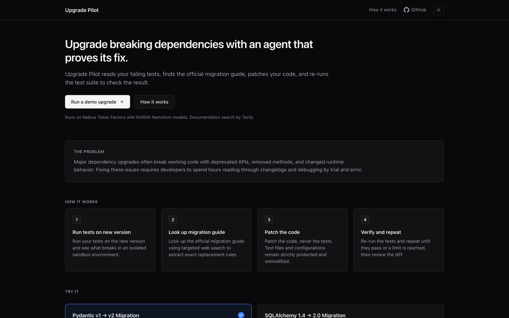
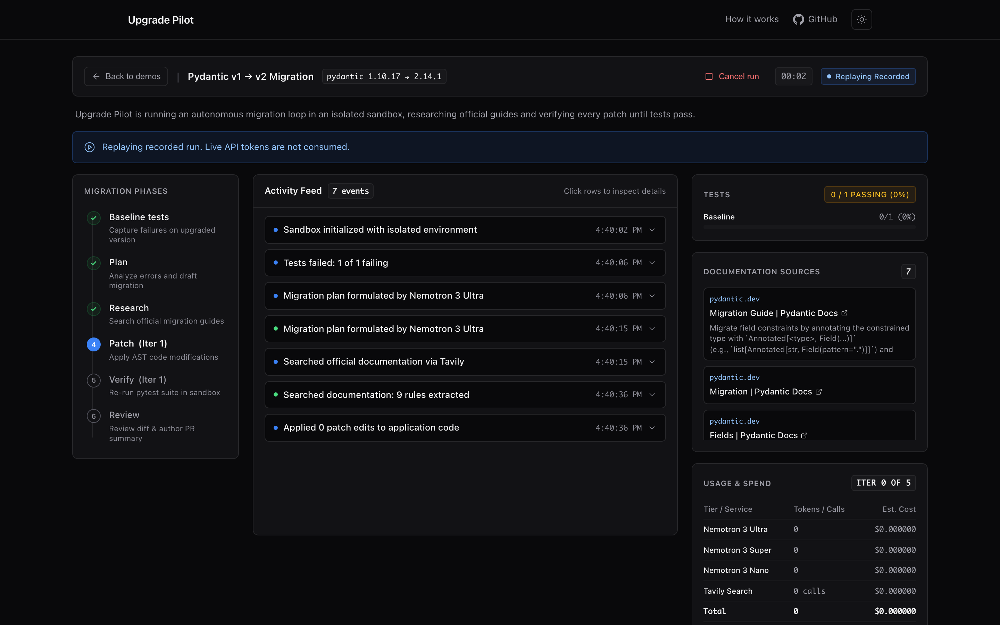
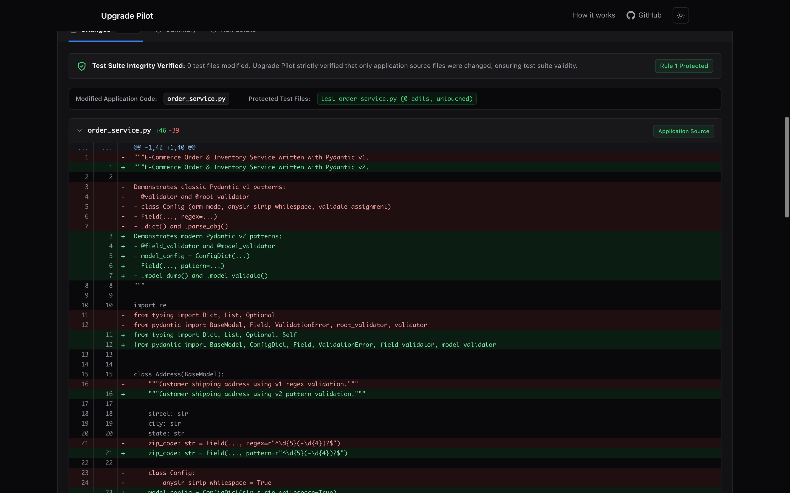

# Upgrade Pilot

**Autonomous Python Dependency Migration Agent**  
*Built for the Nebius x NVIDIA Global AI Hackathon — Coding and Agentic Engineering Track*

[](LICENSE)
[](https://www.python.org/downloads/)
[](https://www.nvidia.com)
[](https://nebius.com)

---

## Pitch

Every engineering team dreads major dependency upgrades. When foundational libraries like **Pydantic** (v1 → v2) or **SQLAlchemy** (1.4 → 2.0) introduce breaking changes, codebases break across dozens of models and services, documentation is scattered across sprawling changelogs, and developers lose days to trial-and-error refactoring. Generic chat models frequently fail because their training data blends deprecated and modern APIs. **Upgrade Pilot** is an autonomous, closed-loop agentic engineer that provisions an isolated sandbox, reproduces failing tests, grounds its refactoring in official migration guides via **Tavily Search** and **NVIDIA Nemotron 3 Nano**, generates AST-validated code patches with **Nemotron 3 Super**, and iterates until the test suite is 100% green—delivering an architectural plan, verified diff, and PR-ready risk review from **Nemotron 3 Ultra**.

---

## What It Does and Who It's For

Upgrade Pilot is designed for **Python backend engineers, platform teams, and open-source maintainers** who need to modernize legacy codebases without manual trial-and-error.

Rather than suggesting unverified snippets in a chat window, Upgrade Pilot executes a closed feedback loop:
1. It runs the real test suite in an ephemeral virtual environment against upgraded package wheels.
2. It reads failure tracebacks and fetches the exact official migration documentation.
3. It patches the application code—**strictly protecting test files and test configuration from modification**.
4. It re-runs the test suite in the sandbox after each patch attempt, iterating until all tests pass or a safety cap is reached.
5. It produces a production-ready Pull Request summary with live documentation links, diff inspection, and a runtime risk analysis of behavioral shifts not exercised by existing unit tests.

---

## How It Works

The agent executes four sequential stages matching the interface:

```
[ 1. Run tests on new version ]
        ↓
[ 2. Look up migration guide ]
        ↓
[ 3. Patch the code (never tests) ]
        ↓
[ 4. Verify and repeat ]
```

1. **Run tests on new version**: Provisions an ephemeral execution sandbox, installs upgraded dependencies offline from a pre-built wheelhouse, and captures baseline failure tracebacks.
2. **Look up migration guide**: Queries the official documentation domains via Tavily Search API, and distills raw changelogs into concise, actionable migration rules using Nemotron 3 Nano.
3. **Patch the code**: Applies targeted code replacements via Nemotron 3 Super. Application source code is updated while test files (`test_*.py`, `conftest.py`, `pytest.ini`) remain strictly immutable.
4. **Verify and repeat**: Re-runs `pytest` in the sandbox. If tests fail, new tracebacks feed into the next iteration (capped at 5 iterations or 60,000 tokens). Once green, Nemotron 3 Ultra conducts a final diff review.

---

## Architecture

```mermaid
flowchart TD
    subgraph UI["Frontend (Single-Page App)"]
        Browser["Developer-Tool Dashboard\n(Vanilla JS + CSS System + SSE)"]
        DiffUI["Interactive Diff & PR Viewer"]
        CostGauge["Real-Time Token & Cost Meter"]
    end

    subgraph Server["FastAPI Backend (Python 3.11+)"]
        Streamer["SSE Event Streamer\n(/api/upgrade/stream)"]
        BudgetGuard["Rate Limiter & Daily Cap\n(rate_limiter.py)"]
        Patcher["AST Patcher & Protected-File Guard\n(patcher.py)"]
    end

    subgraph NebiusTF["Nebius Token Factory (OpenAI API)"]
        Ultra["Nemotron 3 Ultra 550B\n(Plan & PR Review)"]
        Super["Nemotron 3 Super 120B\n(Targeted Code Patching)"]
        Nano["Nemotron 3 Nano 30B\n(Fast Search Summarization)"]
    end

    subgraph Grounding["Real-Time Documentation"]
        Tavily["Tavily Search API\n(Official Docs & Changelogs)"]
    end

    subgraph Sandbox["Isolated Execution Sandbox"]
        TempVenv["Ephemeral Run Dir\n(/tmp/upgrade_pilot_runs/...)"]
        Wheelhouse["Local Wheelhouse\n(wheelhouse/*.whl)"]
        PytestProc["Subprocess Pytest Runner\n(rlimit + timeout)"]
    end

    Browser -->|1. Select Demo & Run| Streamer
    Streamer --> BudgetGuard
    BudgetGuard --> TempVenv
    Wheelhouse -->|2. Offline pip install| TempVenv
    TempVenv -->|3. Run Pytest Baseline| PytestProc

    PytestProc -->|4. Failure Tracebacks| Ultra
    Ultra -->|5. Migration Plan| Streamer

    PytestProc -->|Targeted Keywords| Tavily
    Tavily -->|Official Docs| Nano
    Nano -->|6. Synthesized Rules & URLs| Streamer

    Streamer -->|7. Plan + Rules + Code| Super
    Super -->|8. Structured Edits| Patcher
    Patcher -->|9. AST Validate & Write| TempVenv
    TempVenv -->|10. Re-run Pytest| PytestProc

    PytestProc -->|11. All Green (or Max Iterations)| Ultra
    Ultra -->|12. GitHub PR Summary & Risk Review| Streamer

    Streamer --> Browser
    Streamer --> CostGauge
    Streamer --> DiffUI
```

---

## How We Use NVIDIA Nemotron

Upgrade Pilot implements a **tri-tier model specialization strategy** via Nebius Token Factory, matching each agent task to the ideal model size, reasoning depth, and latency characteristics:

| Model Tier | Model Identifier | Role | Why This Model? |
| :--- | :--- | :--- | :--- |
| **Nemotron 3 Ultra** | `nvidia/Nemotron-3-Ultra-550b-a55b` | Architectural Migration Planning & Final PR Review | 550B MoE with deep chain-of-thought reasoning. Analyzes full codebase ASTs and cross-file relationships, and generates comprehensive GitHub PR descriptions with breaking-change risk analyses and documentation citations. |
| **Nemotron 3 Super** | `nvidia/nemotron-3-super-120b-a12b` | Targeted Code Patching & Error Repair | 120B MoE with high code-generation precision. Generates concise Search/Replace blocks or full-file replacements. Auto-repairs malformed syntax when prompted. |
| **Nemotron 3 Nano** | `nvidia/NVIDIA-Nemotron-3-Nano-30B-A3B` | Real-Time Documentation Summarization | 30B MoE with near-instantaneous time-to-first-token (TTFT). Condenses dense 800-word documentation pages from Tavily into precise 1-sentence actionable migration rules at negligible cost ($0.10/1M input). |

### Granular Reasoning Token Extraction
Both Nemotron 3 Ultra and Nemotron 3 Super generate deep internal reasoning chains (often 500–2,500 tokens). Upgrade Pilot inspects completion payloads to extract `usage.completion_tokens_details.reasoning_tokens`, providing transparent insight into model thinking time and accurate cost calculations on the live telemetry dashboard.

---

## Where Nebius Token Factory Helped

All model inference in Upgrade Pilot runs strictly through **Nebius Token Factory** (`https://api.studio.nebius.ai/v1`). It provided:

1. **Standard OpenAI-Compatible API**:
   Enabled seamless interaction with 30B, 120B, and 550B NVIDIA Nemotron models through the standard `openai` Python SDK by configuring `base_url="https://api.studio.nebius.ai/v1"`. No proprietary client wrappers or CUDA dependencies required.
2. **High-Throughput MoE Inference**:
   Running a 550B parameter model like Nemotron 3 Ultra and a 120B model like Nemotron 3 Super with multi-thousand token reasoning chains delivered the low latency required to keep the live web UI responsive.
3. **Transparent Per-Call Token Accounting**:
   Nebius passes granular usage statistics in completion payloads (including `prompt_tokens`, `completion_tokens`, and `completion_tokens_details.reasoning_tokens`), enabling live USD cost calculation.
4. **Other Nebius Services**:
   Outside of Token Factory, the web server and sandbox runtime can deploy as a standard container onto **Nebius Cloud Compute**. For the hackathon submission, all model inference runs strictly through Nebius Token Factory endpoints.

---

## How Tavily Is Used

General LLMs frequently hallucinate deprecated methods or confuse v1 vs v2 syntaxes. Upgrade Pilot grounds its agent in live, ground-truth documentation:

1. When baseline tests fail, the agent analyzes breaking symbols and error messages.
2. It generates targeted documentation queries (e.g., `pydantic v2 migration guide regex pattern Field replacement`).
3. It calls the **Tavily Search API** (`POST https://api.tavily.com/search`) with `include_domains` restricted to official documentation domains (`docs.pydantic.dev`, `pydantic.dev`, `docs.sqlalchemy.org`, `sqlalchemy.org`).
4. **Nemotron 3 Nano** summarizes each search result into a concise, actionable migration rule.
5. All source URLs and titles are retained and rendered as hyperlinked citations in the live timeline and final PR description.
6. **Fault Tolerance**: If a network error occurs, the Tavily client retries with exponential backoff. If the API request still fails or if no API key is provided, the agent surfaces a visible warning in the UI and continues with a clearly labeled `"no external docs available"` note. It never silently substitutes fake or hardcoded mock documentation.

---

## Limitations and Honest Caveats

- **Language Scope**: Currently optimized for Python codebases using `pytest`.
- **Sandbox Security**: To prevent arbitrary remote code execution on the public server, arbitrary repository uploads are disabled; execution is strictly restricted to the two preset demo repositories.
- **Demo Scope**: Includes two verified demo services:
  - `demo_pydantic`: Pydantic 1.10.17 → 2.14.1 (10 tests; fails collection on v2; upgrades Field regex, validators, ConfigDict, serialization).
  - `demo_sqlalchemy`: SQLAlchemy 1.4.54 → 2.0.55 (8 tests; 2 tests fail on 2.0; upgrades engine.execute removal, session.get, and text constructs).
- **Execution Caps**: Runs are capped at 5 iterations, 60,000 tokens, and 300 seconds timeout to prevent runaway execution or spend.
- **Public Spend Cap**: A global daily spend limit ($10.00 / 500,000 tokens) guards the shared demo instance; when reached, users are invited to watch a recorded run.

---

## Local Setup & Run Instructions

### Prerequisites
- Python 3.11+
- Virtual environment tool (`venv`)
- Git

### Quickstart (Local Virtualenv)

```bash
# 1. Clone the repository
git clone https://github.com/ritesh-1912/Nebius-Hackathon.git
cd Nebius-Hackathon

# 2. Create virtual environment
python3 -m venv .venv
source .venv/bin/activate

# 3. Install dependencies
pip install -r requirements.txt
pip install -e . --no-deps

# 4. Configure environment variables
cp .env.example .env
# Edit .env with your NEBIUS_API_KEY and TAVILY_API_KEY

# 5. Run the automated test suite (32 tests)
pytest -v

# 6. Populate local offline wheelhouse (optional on Mac, required for offline sandbox tests)
python scripts/build_wheelhouse.py

# 7. Verify sandbox execution proof (100% green on old versions, broken on new versions)
python scripts/verify_sandbox.py

# 8. Start the web application
uvicorn upgrade_pilot.main:app --host 0.0.0.0 --port 8000 --reload
```
Open **`http://localhost:8000`** in your browser.

---

## Docker Setup & Deployment

### Run with Docker Locally

```bash
# Build production image (pre-builds Linux wheelhouse inside image, runs as non-root 'pilot')
docker build -t upgrade-pilot .

# Run with environment secrets mounted at runtime
docker run --rm -it -p 8000:8000 --env-file .env upgrade-pilot
```

### Production Deployment (Render)

Upgrade Pilot is pre-configured for 1-click deployment on **Render** via [`render.yaml`](render.yaml). See [`DEPLOY.md`](DEPLOY.md) for full instructions.

---

## Environment Variables

All settings are configured through environment variables:

| Variable | Default | Purpose |
| :--- | :--- | :--- |
| `NEBIUS_API_KEY` | *(None)* | Nebius Token Factory API key. If omitted, app serves recorded runs. |
| `NEBIUS_BASE_URL` | `https://api.studio.nebius.ai/v1` | Endpoint URL for Nebius Token Factory. |
| `MODEL_ULTRA` | `nvidia/Nemotron-3-Ultra-550b-a55b` | Model ID for Ultra tier: planning and PR reviews. |
| `MODEL_SUPER` | `nvidia/nemotron-3-super-120b-a12b` | Model ID for Super tier: targeted code patches. |
| `MODEL_NANO` | `nvidia/NVIDIA-Nemotron-3-Nano-30B-A3B` | Model ID for Nano tier: Tavily documentation summary. |
| `TAVILY_API_KEY` | *(None)* | Tavily Search API key for official documentation lookup. |
| `DAILY_SPEND_LIMIT_USD` | `10.0` | Global daily spending limit in USD before offering cached runs. |
| `DAILY_TOKEN_LIMIT` | `500000` | Global daily token consumption cap. |
| `MAX_CONCURRENT_RUNS` | `1` | Concurrency limit for simultaneous live upgrade runs. |
| `PER_RUN_TIMEOUT_SECONDS` | `300` | Hard timeout cap per upgrade run. |
| `MAX_TOKEN_BUDGET` | `60000` | Per-run token consumption ceiling. |
| `MAX_ITERATIONS` | `5` | Maximum test/fix loop iterations per run. |
| `SANDBOX_TIMEOUT_SECONDS` | `25` | Per-command timeout for pytest and pip invocations. |

---

## Screenshots

### 1. Landing Page
*Clean, restrained developer-tool interface with 4 clear steps, demo selection cards, and "Under the hood" spec table.*



### 2. Live Run View
*Header strip with elapsed timer, vertical phase stepper, expandable activity feed, and live multi-tier token/cost telemetry.*



### 3. Deliverables & PR Review
*Unified diff viewer confirming test files are untouched, paired with the Nemotron 3 Ultra architectural PR summary and risk review.*



---

## License

This project is open-source under the [MIT License](LICENSE).
